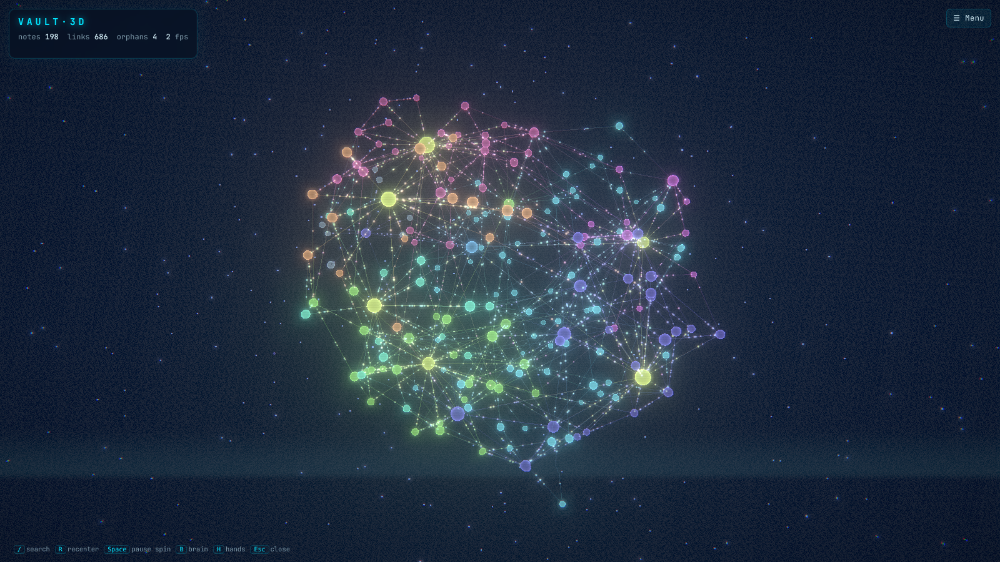
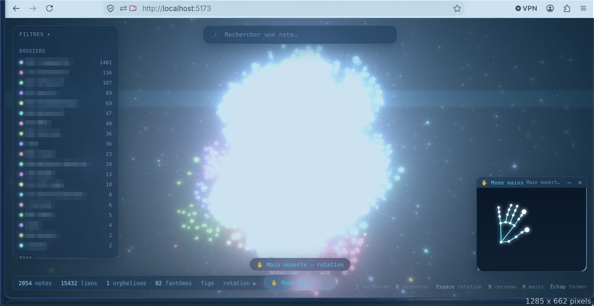

<div align="center">

# VAULT·3D

**Votre second cerveau Obsidian en hologramme 3D, contrôlé à mains nues.**

[](https://YojoxSn.github.io/vault-3d/)



[English](README.md)

</div>

---

## Essayer en 10 secondes

1. Ouvrez la **[démo en ligne](https://YojoxSn.github.io/vault-3d/)** et cliquez sur **Explore the demo**.
2. Appuyez sur **H**, autorisez la caméra, levez la main (bonne lumière, 40 à 80 cm de la caméra).
3. Ou **déposez le dossier de votre vault** sur la page. Vos notes sont lues dans l'onglet du navigateur et **ne sont jamais envoyées**.

## Gestes

| Geste | Effet |
|---|---|
| ✋ Main ouverte qui bouge | Fait tourner le cerveau |
| 🤏 Pincement bref sur une sphère | Vole vers la note et l'ouvre |
| 🤏 Pincement maintenu qui bouge | Attrape et fait tourner |
| 🤏🤏 Deux mains pincées qui s'écartent / se rapprochent | Zoom avant / arrière |
| ☝️ Index pointé | Curseur 3D qui éclaire la note et ses voisines |
| ✊ Poing tenu 0,6 s | Fige / relance la rotation automatique |
| 👋 Balayage rapide gauche / droite | Note liée précédente / suivante |
| 🙌 Deux paumes vers la caméra, 0,6 s | Recentre la vue |

Tout fonctionne aussi à la souris et au clavier.

## Lancer en local

```bash
git clone https://github.com/YojoxSn/vault-3d.git
cd vault-3d
npm install
npm run dev          # http://localhost:5173
```

Pour charger votre vault automatiquement:

```bash
cp .env.example .env        # puis renseignez VAULT_PATH=/chemin/vers/votre/vault
npm run dev                 # régénère le graphe depuis votre vault à chaque lancement
```

`.env`, `public/graph.json` et `public/content.json` (qui contiennent le texte de vos notes) sont ignorés par git. Le vault est lu en **lecture seule**.

## Comment c'est fait

Construit en conversation avec [Claude Code](https://claude.com/claude-code) à partir de deux prompts, puis emballé pour tout le monde (vault de démo, glisser-déposer, tests, Pages).

- 📝 **[Les prompts](docs/PROMPTS.md)**: copiez-les, mettez le chemin de votre vault, obtenez votre version.
- 🛠 **[Comment ça a été fait](docs/COMMENT-CA-A-ETE-FAIT.md)**: la méthode, les problèmes rencontrés, comment refaire et publier votre copie.



## Limites connues

- Les gestes sont testés par des tests unitaires sur des **mains simulées** et la chaîne complète tourne dans un vrai navigateur, mais **les seuils restent à affiner sur d'autres webcams et éclairages**. Les constantes sont dans `src/hands/engine.ts` (`CFG`) et `src/hands/gestures.ts`.
- Si « deux paumes » se déclenche avec le dos des mains, mettez `PALM_FLIP = true` dans `src/hands/gestures.ts`.
- La forme « cerveau » est expérimentale.

Licence [MIT](LICENSE). Non affilié à Obsidian ni à Marvel.
