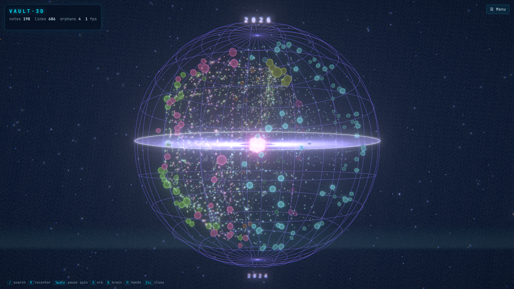
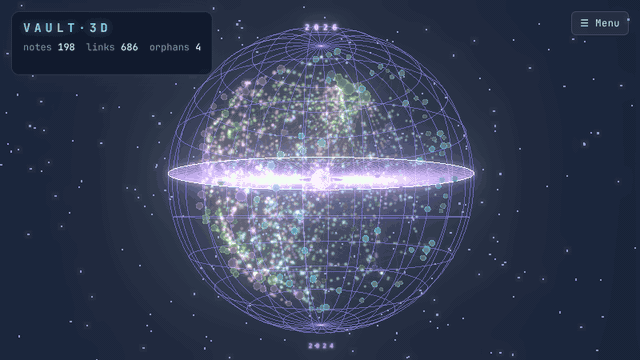
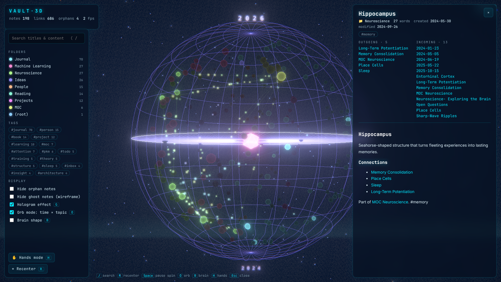
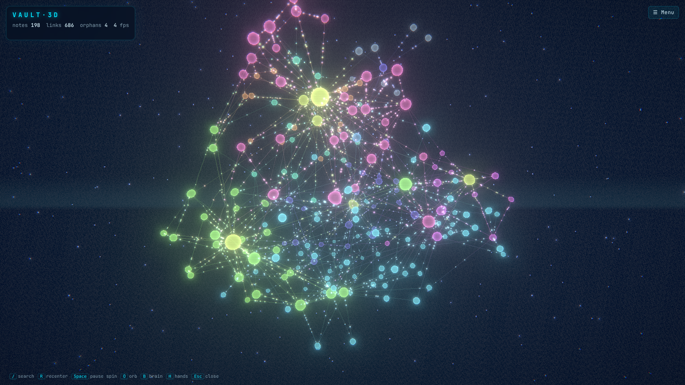
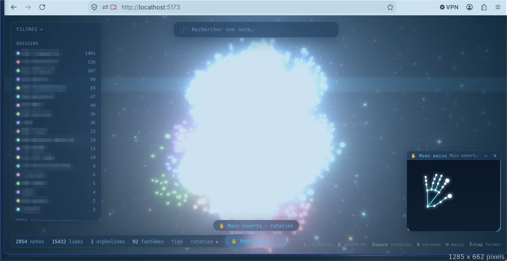

<div align="center">

# VAULT·3D

**Your Obsidian second brain as a 3D hologram, controlled with your bare hands.**

[](https://YojoxSn.github.io/vault-3d/)




[Français](README.fr.md)

</div>

---

## What is this?

Vault 3D turns the notes of an [Obsidian](https://obsidian.md) vault into an **interactive 3D hologram**: every note is a glowing sphere, every link a light beam, and you can rotate, zoom and open notes with **your hands, through your webcam**, like Tony Stark in Iron Man.

It runs **entirely in your browser**: your notes and your camera never leave your computer. This whole project was built with **[Claude Code](https://claude.com/claude-code) from a prompt**, and the prompt is below so you can do the same.

## Try it

1. Open the **[live demo](https://YojoxSn.github.io/vault-3d/)** (a fictional vault of 198 notes, nothing to install).
2. Press **H**, allow the camera, hold up your hand (good light, 40–80 cm from the camera).
3. Or **drop your own vault folder** on the page. It is read inside your browser tab and is never uploaded.

If it makes you smile, **⭐ star the repo**: it is the main way other people find it. Made a clip with your own vault? Share it with `#Vault3D`.

## The prompt

Paste this into Claude Code, started in an **empty folder** (not in your vault). It is a short English version; the complete original French prompt is in **[PROMPT.md](PROMPT.md)**.

<details>
<summary><b>Show the prompt</b></summary>

```text
Create an interactive 3D visualization of ALL my Obsidian vault with Three.js,
controllable with my hands through the webcam, like Tony Stark's hologram in Iron Man.

Context
- My vault is here: <PATH/TO/MY/VAULT>   (name: <NAME>)
- Local web app: Vite + TypeScript + Three.js (no heavy framework), started with `npm run dev`.

Step 1 - Import the vault: a Node script walks the vault (ignore .obsidian/, .trash/),
parses [[wikilinks]], [[Note|alias]], [text](Note.md), #tags and YAML frontmatter tags,
resolves links like Obsidian does; links to missing notes become "ghost" nodes.
The vault stays READ-ONLY. Live mode with chokidar.

Step 2 - 3D scene: one glowing sphere per note (size = connections, color = root folder),
glowing links with particles flowing along them, d3-force-3d layout, bloom, fog, stars,
scanlines. InstancedMesh: it must stay smooth with 3000+ notes.

Step 3 - Hand control (MediaPipe Tasks Vision): a floating camera window with a neon skeleton.
Open hand = rotate, pinch = grab / click, two-hand pinch = zoom, pointing = 3D cursor,
fist = freeze the rotation, swipe = previous / next linked note, two palms = recenter.
Smooth the hands (One Euro filter). Everything must also work with mouse and keyboard.
The video never leaves the browser.

Step 4 - Side panel with the full note, search ( / ), filters, "Open in Obsidian" button.
Step 5 - HUD, color legend, modular code, tests for gesture recognition with simulated points.
At the end, give me the exact commands to install and run it.
```

</details>

**What to expect.** The prompt gives you a working first version. An AI writes the code, so two runs will not give the exact same files. Hand tracking may need a round of tuning for your webcam: tell Claude Code what feels wrong. This repository is that result, plus polish (Orb mode, a demo vault, tests, one-click deployment).

## The result



*Captured from the live demo with mouse and keyboard. A clip of the hand control is coming.*







*First version on a real 2,054-note vault, hands mode on. Folder names are blurred and the camera view is replaced for privacy.*

## Controls

| Gesture | Effect |
|---|---|
| ✋ Open hand, moving | Rotate |
| 🤏 Quick pinch on a sphere | Fly to the note and open it |
| 🤏 Pinch, hold and move | Grab and spin |
| 🤏🤏 Two hands pinched, spread / bring together | Zoom |
| ☝️ Pointing | 3D cursor, lights up the note and its neighbours |
| ✊ Fist, held 0.6 s | Freeze / resume the auto-rotation |
| 👋 Fast swipe left / right | Previous / next linked note |
| 🙌 Both palms toward the camera | Recenter |

Keys: `/` search · `O` orb / free network · `B` brain shape · `G` hologram effect · `H` hands · `P` share card · `Q` quality · `R` recenter · `Space` pause · `Esc` close.

**Insights** (left panel): your *backbone* (most connected notes), notes to **write next** (linked but not written yet), orphans to **connect**, and well-connected notes you may want to **revisit**. Click one to jump to it.

**Share card** (`P` or the 📸 button): saves a picture of your own vault with its numbers. It contains **only counts, never note titles**, so it is safe to post.

**Orb mode** (default): notes sit on a glass globe. Height = time (newest at the north pole), wedge = folder, well-connected notes sink toward the glowing core.

## Run it on your computer

```bash
git clone https://github.com/YojoxSn/vault-3d.git
cd vault-3d/app
npm install
npm run dev          # http://localhost:5173
```

To load your vault automatically, copy `.env.example` to `.env` and set `VAULT_PATH`. Your notes are read-only, and `.env` plus the generated files are git-ignored. More details for developers: [app/README.md](app/README.md).

## Honest limits

- **Performance depends on your graphics card.** The quality adapts by itself (Auto) and you can force it with `Q` or the Quality menu: High, Medium, Low. If it still stutters, check that hardware acceleration is enabled in your browser (`chrome://gpu` should say "WebGL: Hardware accelerated").
- The gestures are tested on **simulated hands** and in a real browser pipeline, but **webcams, lighting and hands vary**: thresholds may need tuning. Please open an issue with your setup.
- The frame rate on a real GPU with 2,000+ notes has not been benchmarked yet (parsing and layout have: 0.2 s and about 5 s for 2,000 notes).
- Only `.md` notes become nodes; attachments are ignored.

## License

[MIT](LICENSE). Not affiliated with Obsidian or Marvel.
