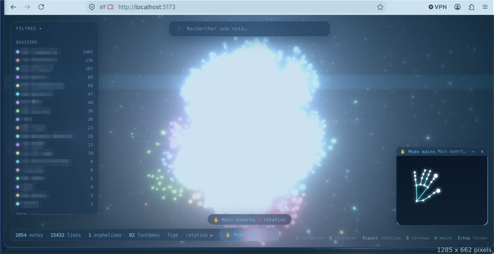

# Comment ce projet a été fait

Vault 3D a été construit en conversation avec **[Claude Code](https://claude.com/claude-code)**, l'assistant de programmation d'Anthropic en ligne de commande: vous décrivez ce que vous voulez, il écrit le code, lance le build et les tests, puis corrige ce qui casse. Cette page explique la méthode pour que vous puissiez refaire la même chose avec votre vault, ou avec une tout autre idée.

Les deux prompts sont dans [PROMPTS.md](PROMPTS.md).

## La méthode en cinq temps

1. **Écrire un prompt précis, par étapes.** D'abord le contexte (technologies, où sont vos données), puis des étapes numérotées avec un livrable concret. Mettez des variables à remplacer (`<CHEMIN/VERS/MON/VAULT>`) pour tout ce qui est personnel.
2. **Démarrer dans un dossier de projet vide, pas dans votre vault.** Le vault doit rester en lecture seule. (Pendant la première construction, des fichiers ont été créés à la racine du vault par erreur; l'assistant l'a vu, les a supprimés et a continué au bon endroit. Démarrer ailleurs évite le problème.)
3. **Lui faire vérifier chaque étape** (typecheck, build, tests) avant de continuer, et lui demander de dire **ce qu'il n'a pas pu vérifier**. Ici: le rendu 3D, le comportement sur une vraie webcam et l'orientation gauche/droite des paumes.
4. **Tester soi-même et lui rapporter ce qu'on voit.** Ouvrez la page, `F12`, copiez les messages rouges de la console dans la conversation. Cette boucle corrige les bugs très vite.
5. **Itérer avec un second prompt plus ambitieux.** Le premier a donné la visualisation; le second a ajouté le contenu complet des notes, l'effet hologramme, la forme de cerveau et le contrôle par les mains.

## Ce qui a été produit

| Prompt | Résultat |
|---|---|
| 1 | Parseur du vault (liens, tags, notes fantômes), scène 3D (sphères, liens lumineux, particules), survol / clic / panneau / recherche / filtres |
| 2 | Contenu complet des notes, effet hologramme, forme de cerveau, layout dans un Web Worker, contrôle par les mains (MediaPipe) avec un moteur de gestes testé |
| Mise en ligne | Vault de démo public, glisser-déposer d'un dossier, déploiement GitHub Pages, README, cette documentation |

Sur le vrai vault de l'auteur (2 054 notes, environ 15 000 liens), la première version a tout analysé en 1,4 s environ.



*Première version, sur un vrai vault de 2 054 notes, mode mains actif. Les noms de dossiers sont floutés et l'image de la caméra a été remplacée pour la confidentialité.*

## Problèmes rencontrés

- **Un plantage du bundler.** Vite 8 échouait sur la machine de l'auteur, le projet utilise donc Vite 6.
- **Un layout trop lent** (4 à 6 s d'images saccadées avec 15 000 liens), déplacé dans un **Web Worker**; la force de collision a été retirée.
- **Des bugs de gestes trouvés par les tests, pas à l'œil.** Écrire 22 tests avec des points de main simulés a révélé deux vrais bugs (le pincement et le balayage lisaient la position filtrée au lieu de la brute).
- **Ensuite, sur la version publiée:** un clic pouvait être pris pour un glissement parce que le point milieu du pincement dérive quand le pouce s'ouvre (corrigé en suivant le bout de l'index), les tags YAML écrits en liste étaient mal lus, et un fichier illisible (par exemple un fichier iCloud non téléchargé) pouvait bloquer tout l'import.

## Limites assumées

Les seuils des gestes sont validés sur des mains simulées et dans une vraie chaîne navigateur, mais **webcams, éclairages et mains varient**: voyez [Status and honest limits](../README.md#status-and-honest-limits) et dites-nous ce qui marche chez vous.

## Refaire avec votre vault

```bash
# 1. Installez Claude Code (voir sa documentation), puis dans un dossier VIDE:
mkdir mon-vault-3d && cd mon-vault-3d
claude
# 2. Collez le prompt 2 de docs/PROMPTS.md après avoir remplacé <CHEMIN/VERS/MON/VAULT> et <NOM>
# 3. Quand c'est fini, lancez les commandes qu'il vous donne, en général:
npm install && npm run dev
```

Ou sautez tout ça et clonez simplement ce dépôt: [README](../README.fr.md).

## Publier votre copie

1. Créez un dépôt vide sur <https://github.com/new>.
2. Dans le dossier du projet: `git init -b main`, `git add .`, **vérifiez `git status`**, `git commit`, `git remote add origin …`, `git push -u origin main`.
3. **Settings → Pages → Source: GitHub Actions** pour obtenir une démo en ligne.
4. Ne commitez jamais `.env`, `public/graph.json` ni `public/content.json`: ils contiennent vos notes. Ils sont ignorés par git ici.
