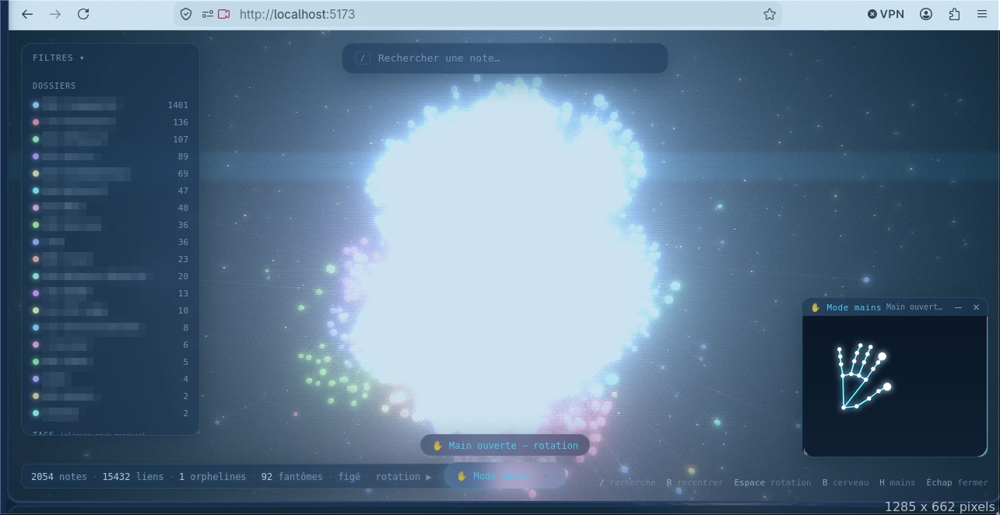

# How this project was made

Vault 3D was built in conversation with **[Claude Code](https://claude.com/claude-code)**, Anthropic's coding assistant for the terminal: you describe what you want, it writes the code, runs the build and the tests, and fixes what breaks. This page explains the method so you can do the same with your own vault, or a completely different idea.

The two prompts are in [PROMPTS.md](PROMPTS.md).

## The method, in five moves

1. **Write a precise prompt, in steps.** Context first (stack, where your data lives), then numbered steps with concrete deliverables. Use placeholders for anything personal.
2. **Start in an empty project folder, not in your vault.** The vault must stay read-only. (During the first build, files were briefly created at the root of the vault by mistake; the assistant noticed, deleted them and carried on in the right folder. Starting elsewhere avoids it altogether.)
3. **Let it verify each step** (typecheck, build, tests) before moving on, and ask it to tell you **what it could not verify**. Here that was the 3D rendering, real webcam behaviour and the left/right palm orientation.
4. **Test it yourself and report back.** Open the page, press `F12`, copy the red console messages into the chat. That loop is how bugs get fixed fast.
5. **Iterate with a second, more ambitious prompt.** The first prompt produced the visualization; the second added full note content, the hologram look, the brain shape and the hand control.

## What was produced

| Prompt | Result |
|---|---|
| 1 | Vault parser (links, tags, ghost notes), 3D scene (spheres, glowing links, particles), hover / click / panel / search / filters |
| 2 | Full note content, hologram effect, brain shape, layout in a Web Worker, MediaPipe hand control with a unit-tested gesture engine |
| Packaging | Public demo vault, drag-and-drop a folder, GitHub Pages workflow, README, this documentation |

On the author's real vault (2,054 notes, about 15,000 links) the first version parsed everything in about 1.4 s.



*First version, on a real 2,054-note vault, hands mode on. Folder names are blurred and the camera view has been replaced for privacy.*

## Problems met along the way

- **A bundler crash.** Vite 8 failed on the author's machine, so the project uses Vite 6.
- **A layout that was too slow** (about 4 to 6 s of choppy frames with 15,000 links) was moved into a **Web Worker**; the force of collision was dropped.
- **Gesture bugs found by tests, not by eye.** Writing 22 tests with simulated hand landmarks exposed two real bugs (pinch and swipe read the filtered position instead of the raw one).
- **Later, on the published version:** a click could be mistaken for a drag because the pinch midpoint drifts when the thumb opens (fixed by tracking the index fingertip), YAML tags written as a list were misread, and one unreadable file (for example an iCloud placeholder) could block the whole import.

## Honest limits

The gesture thresholds are validated on simulated hands and in a real browser pipeline, but **real webcams, lighting and hands vary**: see [Status and honest limits](../README.md#status-and-honest-limits) and tell us what works for you.

## Reproduce it with your own vault

```bash
# 1. Install Claude Code (see its documentation), then in an EMPTY folder:
mkdir my-vault-3d && cd my-vault-3d
claude
# 2. Paste prompt 2 from docs/PROMPTS.md after replacing <CHEMIN/VERS/MON/VAULT> and <NOM>
# 3. When it is done, run the commands it gives you, usually:
npm install && npm run dev
```

Or skip all that and just clone this repository: [README](../README.md).

## Publish your own copy

1. Create an empty repository on <https://github.com/new>.
2. In the project folder: `git init -b main`, `git add .`, **check `git status`**, `git commit`, `git remote add origin …`, `git push -u origin main`.
3. **Settings → Pages → Source: GitHub Actions** to get a live demo.
4. Never commit `.env`, `public/graph.json` or `public/content.json`: they contain your notes. They are git-ignored here.
